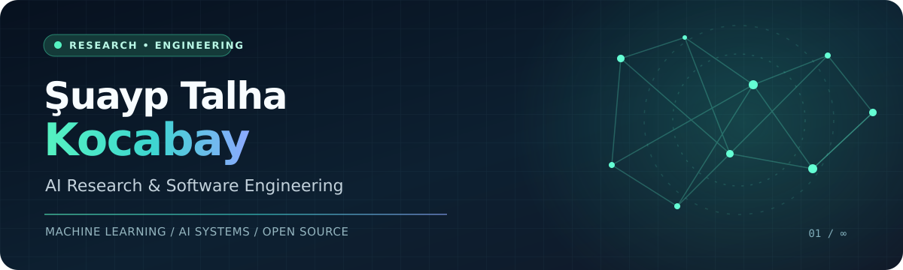

### Hey, I'm Şuayp 👋

*AI research, engineering, and open source.*

### `> about`

**High Schooler at TÜBİTAK Science HS** · **Software Engineer & Researcher at Poindexter Labs** · Also an **intern at TÜBİTAK BİLGEM**.

I work on **machine learning, NLP, efficient language models, and AI systems** — from research ideas to practical software. I enjoy training and merging models, experimenting with new architectures, and sharing what I build with the open-source community.

📄 **Accepted papers:** NeurIPS 2026 Main Conference · ICML 2026 Workshops  
🏅 **IOAI 2025 Silver** · **IAIO 2026 Bronze**  
🤗 Models & experiments on [Hugging Face](https://huggingface.co/suayptalha) · Research on [Google Scholar](https://scholar.google.com/citations?user=wDdjxe4AAAAJ)

### `> stack`

`Transformers` · `PEFT / LoRA` · `Hugging Face` · `FastAPI` · `NumPy` · `pandas`

### `> connect`

**Always open to interesting research and engineering collaborations.**

